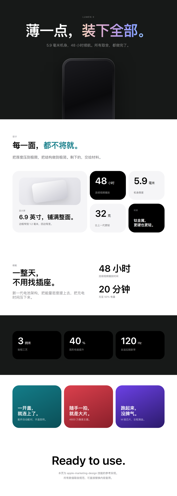

# Apple Marketing Design Language

> 把 Apple 官网那套「大留白、少颜色、字重分层」的版式规律，变成一份可以照着做、还能自动检查的规范。

做"高级感"的设计，最难的从来不是审美，而是**一致性**。这次留白 8%，下次 3%；这次圆角 24px，下次 12px；这次标题染半边，下次整句涂红。每一处偏差都不致命，叠起来就变成"像模板"。

这个项目把六条底线变成了硬参数，并且给了一个脚本，能直接指出你的页面哪里违规、在第几行。



> 想看可交互的版本，直接用浏览器打开 `assets/demo.html`。那是一个完整落地页，全部数值都来自本规范。

---

## 它能帮你做什么

- **写宣传页 / 落地页**：给出结构、间距、字号、配色的具体数值，不用凭感觉调
- **做 PPT 或长图**：便当盒网格（Bento Grid）的骨架规则，主次怎么分、留白留多少
- **写产品文案**：四种标题句式、动词词库、数据怎么写、哪些词不能用
- **验收设计稿**：跑一遍校验脚本，把"不够高级"翻译成可执行的问题清单

**不适合**：后台仪表盘、信息密度极高的工具界面、需要强装饰性的促销活动页。这套语言的前提是"产品够好、图够大"，塞满信息的场景会适得其反。

---

## 快速开始

### 方式一：Claude Code 或其他支持 skills 目录的工具

```bash
git clone https://github.com/<your-name>/apple-marketing-design.git
cd apple-marketing-design
./install/install.sh --target claude
```

安装后重启会话，直接说需求即可，例如"做一个产品落地页，风格要极简、大留白"。

Windows 用 PowerShell：

```powershell
.\install\install.ps1 -Target claude
```

如果提示"禁止运行脚本"，改用：

```powershell
powershell -NoProfile -ExecutionPolicy Bypass -File .\install\install.ps1 -Target claude
```

也可以不跑脚本，手动把 `SKILL.md`、`references/`、`assets/`、`scripts/` 四个部分复制到 `~/.claude/skills/apple-marketing-design/`，效果完全一样。

### 方式二：Codex / Cursor / Gemini CLI 等基于规则文件的工具

这类工具没有 skills 目录，而是读取项目里的规则文件。先装到项目本地：

```bash
./install/install.sh --target codex     # 或 cursor / gemini
```

脚本会把技能复制到 `./.agent-skills/apple-marketing-design/`，并打印一行配置，把它粘到对应文件即可：

| 工具 | 加到哪个文件 |
|---|---|
| Codex | `AGENTS.md` |
| Cursor | `.cursor/rules/apple-marketing-design.mdc` |
| Gemini CLI | `GEMINI.md` |

### 方式三：任何 LLM（手动方式）

不需要安装。把 `SKILL.md` 的内容整段粘进系统提示或对话开头，再把 `references/` 里的文件按需附上即可。技能本身就是纯 Markdown，没有隐藏依赖。

---

## 怎么用

安装完成后，用自然语言描述任务就行：

```
帮我做一个智能手表的官网落地页，要 Apple 那种极简风
这张宣传图不够高级，按规范帮我改一版
把这五个卖点排成便当盒网格，主推续航
写三条产品标题，要求 8 字以内、逗号断句、不用感叹号
```

想主动指定规范细节时，直接报参数：

```
用 53% 留白、40% 图片的版面比例，横向 16pt、纵向 24pt 间距，
圆角按短边 18% 算，强调色用 #147D89
```

---

## 校验器

规范如果只停在文档里，就只是建议。附带一个脚本，把它变成可以执行的检查。

```bash
python scripts/audit_apple_style.py ./你的页面
python scripts/audit_apple_style.py ./dist --json    # 机器可读输出
```

检查六类问题：

| 规则 | 判定标准 |
|---|---|
| 色值越界 | 不在规范色板内（渐变、阴影的中间色自动豁免） |
| 字重超标 | `font-weight` ≥ 700 |
| 行距落空档 | 不在 1.0–1.25 / 1.45–1.60 / 1.75–1.85 三个区间 |
| 间距不合规 | 不是 4 的倍数 |
| 字体族越界 | 混入禁止字体 |
| 文案问题 | 感叹号、黑话用词、超过 40 字无断句的长句 |

输出示例：

```
[FAIL] page.html:3  (weight)  font-weight: 800 超过 Semibold(600)。Apple 最高只用 600，加粗会破坏层级。
[WARN] page.html:2  (spacing) 间距 18px 不是 4 的倍数。规范间距：4/8/12/16/24/32/40/64/96。
[WARN] page.html:5  (copy)    出现感叹号。Apple 中文文案几乎不用感叹号，语气越平，自信越强。

FAIL  检查 1 个文件 | FAIL 8 | WARN 5
```

`FAIL` 必须修，`WARN` 需要判断。退出码 0 表示通过或仅有警告，1 表示存在 FAIL，方便接进 CI。

---

## 规范速查

**六条底线**

| # | 原则 | 判据 |
|---|---|---|
| 1 | 产品是主角 | 图 40% / 空白 53% / 字 7% |
| 2 | 留白是内容 | 页边距 6–8%，模块间距 ≥ 40pt |
| 3 | 层级靠字重 | 一套字族，300 / 400 / 600 三档 |
| 4 | 色彩只做点睛 | 标题只染半边，强调色 ≤ 5% |
| 5 | 非黑即白 | 底色只有黑 / 白 / 近黑 / 近白 |
| 6 | 秩序在 4 倍数里 | 横 16、纵 16 或 24，圆角 = 短边 × 18% |

**色板**

```
纯黑 #000000   深黑底 #171918   近黑文字 #1D1D1F
纯白 #FFFFFF   浅灰底 #F5F5F7   次灰底   #F6F5F8
正文灰 #6C6B6F 注释灰 #86868B   分隔线   #D2D2D7

强调色（一版只用一种）
#147D89 环保青  #DB404D 力量红  #42A288 生态绿
#0031EA 科技蓝  #6C41E6 性能紫
```

**字体与行距**

```
标题  PingFang SC Semibold(600)   48–96pt
数据  PingFang SC Semibold(600)   40–72pt
正文  PingFang SC Light(300)      22pt / 行距 1.5   （氛围型）
说明  PingFang SC Regular(400)    —— / 行距 1.8   （信息型）
西文  SF Pro Display / SF Pro Text
```

关键反常识：**字越细，行距越不能大**。Light 配 1.8 倍会让整段文字飘走。

完整参数在 `references/` 里，四份文档分别对应字体、色彩、布局、文案。

---

## 目录结构

```
apple-marketing-design/
├── SKILL.md                     总纲：原则、参数表、六步工作流、反模式
├── references/
│   ├── typography.md            字重体系、字号阶梯、行距公式、中英混排
│   ├── color-system.md          色板、明暗配对、半边上色法、渐变配方
│   ├── layout-grid.md           留白配比、Bento 网格、圆角计算、多图拼接
│   └── copywriting.md           标题句式、动词词库、数据表达、改写示例
├── assets/
│   ├── apple-tokens.css         CSS 变量 + 组件类，可直接引入
│   └── demo.html                参考实现落地页
├── scripts/
│   └── audit_apple_style.py     合规校验器
└── install/
    ├── install.sh               macOS / Linux 安装脚本
    └── install.ps1              Windows 安装脚本
```

---

## 注意事项

**字体可用性**

规范里写的是 SF Pro 和 PingFang SC，这两个字体在非 Apple 设备上不一定存在。CSS 变量里已经排好了降级链：`SF Pro Display → -apple-system → PingFang SC → Noto Sans SC → Helvetica Neue`。在 Windows 或 Linux 上，实际渲染会落到 Noto Sans SC 或思源黑体，字重层级仍然成立，但字形细节会有差异。需要精确还原时，请自行安装对应字体，本项目不附带任何字体文件。

**数值是参考基线，不是教条**

字号阶梯按 1080px 宽画布制定。换画布时，字号和间距必须**等比缩放**，不能只改字号。校验脚本看不到实际渲染尺寸，这一条只能靠人眼把关。

**校验器的边界**

它做的是静态文本检查，不理解布局语义。以下情况它查不出来：留白比例是否真的达到 53%、主格面积是否够 4 倍、视觉重心是否只有一个。这些需要对照 `references/layout-grid.md` 自检，或者直接看 `demo.html` 找感觉。

**文案检查是启发式的**

黑话词库和感叹号检测基于正则，会误报（比如引用别人的原话）。把它当成提醒，不是判决。

**商标声明**

本项目是独立整理的设计方法研究，与 Apple Inc. 无关联，未获其授权或认可。文中提及的产品名、字体名仅用于说明设计惯例。仓库内不包含任何 Apple 商标、产品图片或字体文件。`demo.html` 用的是虚构品牌与纯 CSS 绘制的示意图。

如果你要把这套风格用于商业项目，请自行确认不侵犯他人商标权与著作权——**学习设计规律**和**复制品牌资产**是两件事。

---

## 常见问题

**Q：装完之后没反应？**
重启会话。大多数工具只在启动时扫描 skills 目录。用 `/skills` 或对应命令确认是否被加载。

**Q：能只用其中一部分吗？**
可以。`references/` 四份文档互相独立，只关心排版就只看 `typography.md` 和 `layout-grid.md`。

**Q：校验脚本能查设计稿（Figma / Sketch）吗？**
不能，它只读 CSS / HTML / JSX / Vue 等文本文件。设计稿需要人工对照清单检查。

**Q：需要联网或 API Key 吗？**
不需要。脚本只用 Python 标准库，离线可跑。

**Q：可以改规范里的数值吗？**
可以，改 `assets/apple-tokens.css` 的 `:root` 变量，并同步 `scripts/audit_apple_style.py` 顶部的色板与间距常量，两边保持一致即可。

---

## 环境要求

- Python 3.8+（校验器）
- 任意支持 Markdown 的 Agent 工具（技能本身）
- 无第三方依赖，无需联网

---

## 许可

MIT。见 [LICENSE](LICENSE)。
